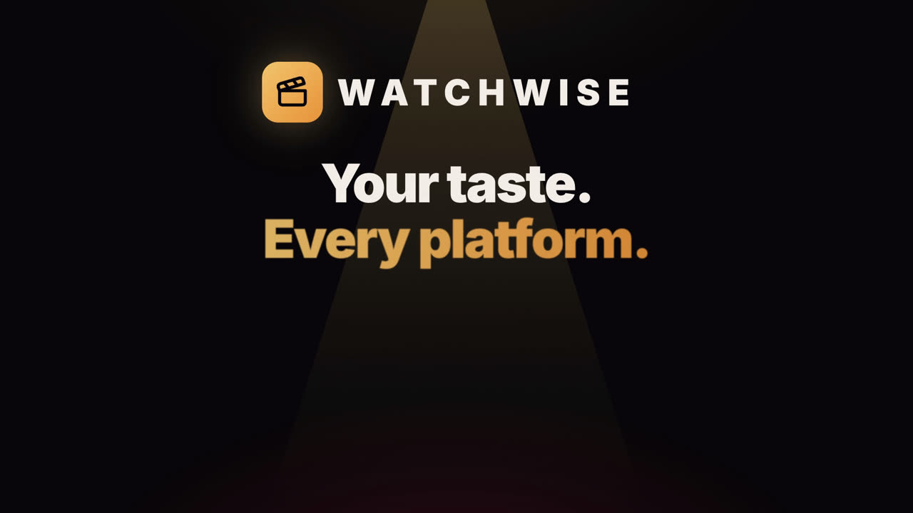
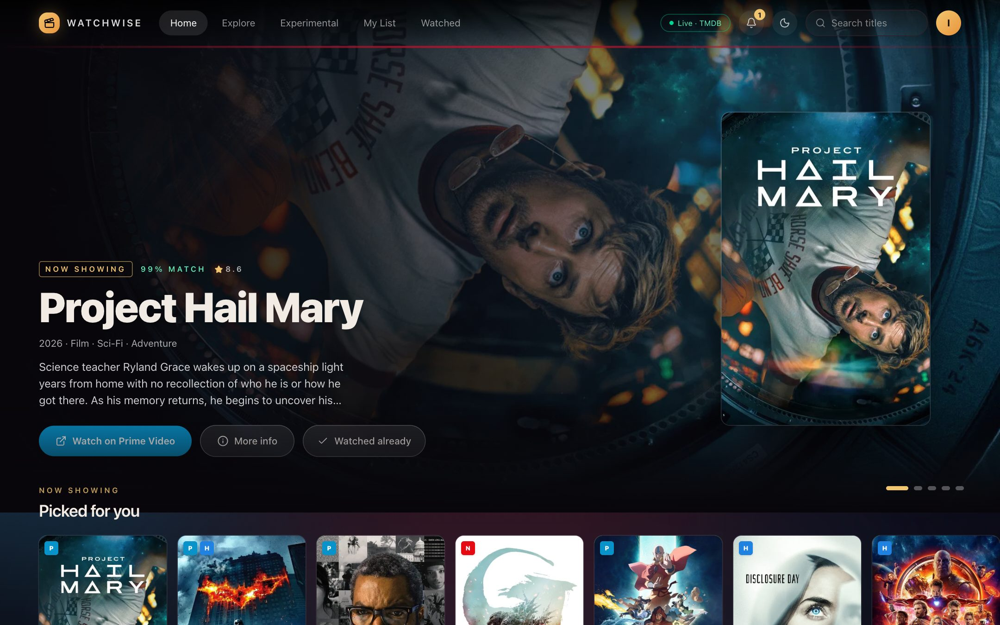
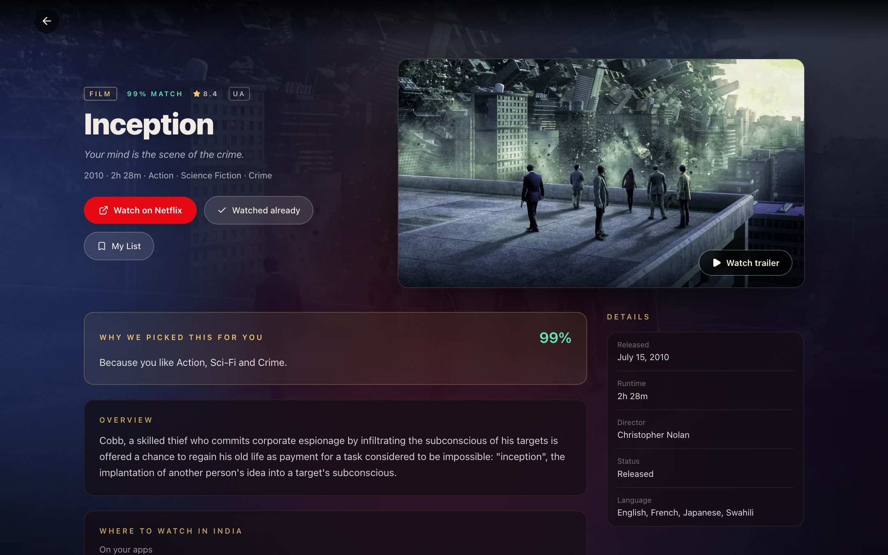
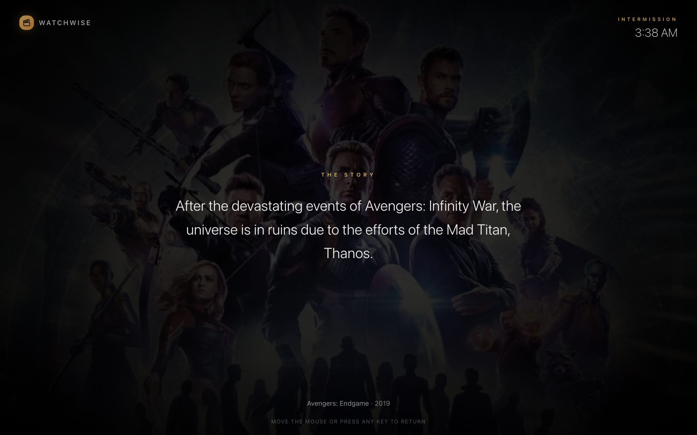
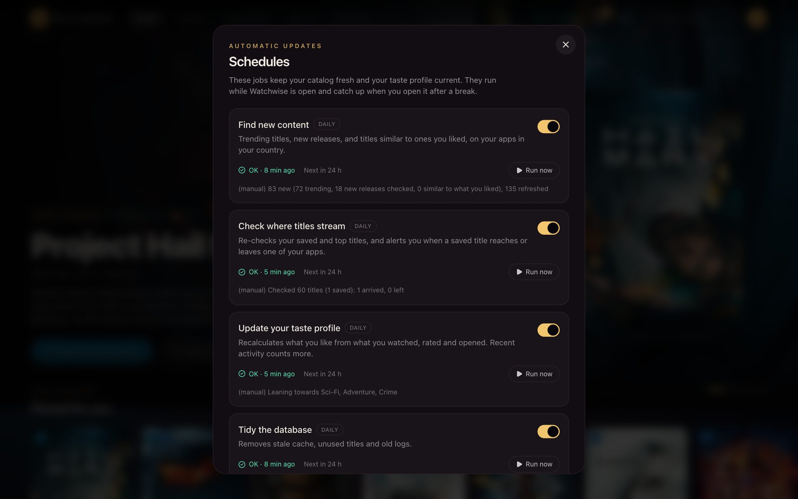
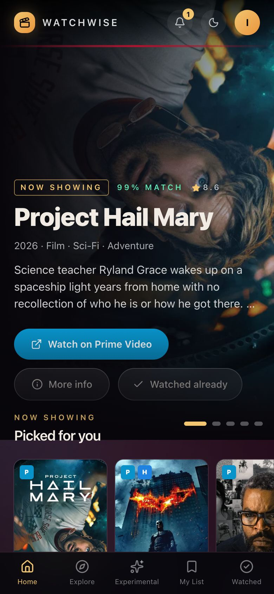
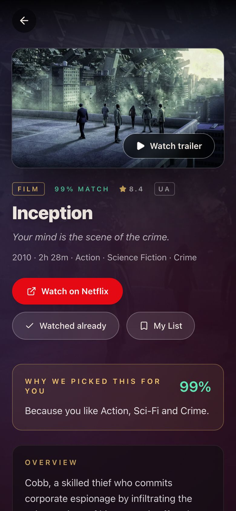

<p align="center">
  
</p>

# Watchwise

**One taste profile across every streaming platform. Private, local and free.**

Every streaming app recommends only from its own catalog, using only what you did on that app. Watchwise keeps a single taste profile on your own computer and shows you what to watch next across all the platforms you actually have, in your country.

> **Status: early stage.** The app, the real TMDB catalog, the title pages, the home-theater trailer player, watch-history learning and the scheduled updates all work today. The AI suggestion engine (your own Claude Code, Codex, Cursor or Gemini) is **not built yet**, so recommendations come from a simple taste score based on your genres, history and usage. See [What works today](#what-works-today) and the [roadmap](ROADMAP.md).

## Watch the intro

<p align="center">
  <a href="docs/watchwise-intro.mp4">
    
  </a>
</p>

<p align="center"><sub>44 seconds, silent. Click the picture to play it on GitHub.</sub></p>

## Why

- Recommendations differ on every platform, and none of them knows your full taste.
- Paid recommendation apps cost money you may not want to spend.
- Your watch history is your data. It should live on your machine, not on someone else's server.

## A look at it

<p align="center">
  
</p>

<table>
  <tr>
    <td width="50%"></td>
    <td width="50%"></td>
  </tr>
  <tr>
    <td><b>Title pages.</b> A framed banner and a plain reason for every pick ("Because you like Sci-Fi and Crime"), then where it streams for you, the cast and similar titles.</td>
    <td><b>Home-theater trailers.</b> The trailer plays in a room seen from your seat. The room's light follows the trailer's colors.</td>
  </tr>
  <tr>
    <td></td>
    <td></td>
  </tr>
  <tr>
    <td><b>Intermission.</b> A calm screen saver of stories, numbers, cast and moments from titles, built only from verified TMDB data.</td>
    <td><b>Schedules.</b> Daily and weekly jobs keep your catalog fresh and your taste current. You can see, run or pause each one.</td>
  </tr>
</table>

<p align="center">
  
  &nbsp;&nbsp;
  
</p>

<p align="center"><sub>Works on phones and desktops.</sub></p>

## What it does

- **One catalog across your apps.** Real titles, posters, backdrops and ratings from TMDB, filtered to what streams on the platforms you picked, in your country. "Watch on Netflix" and friends open the right platform.
- **A taste profile that learns.** It starts from the genres you choose, then learns from what you mark watched and rate, and from what you open, play and click. Recent activity counts more than old.
- **"Watched already."** One button saves a title to your local history, hides it from suggestions, shifts your taste, and pulls in similar new titles.
- **An experimental lane.** A separate "Try something different" row suggests genres you haven't tried, so your taste can grow.
- **Alerts.** A bell tells you when new titles were found, when a title you saved reaches one of your apps, or when it leaves.
- **Private by design.** No login, no cloud. Everything lives in a SQLite file on your computer.

## Automatic updates

Watchwise is local, so there is no server in the cloud. Jobs run while the app is open (checked every minute), and **catch up** when you open it after a break. Open **Schedules** from the profile menu to see each job's last result and next run, switch it off, or run it now.

| Job | When | What it does |
|---|---|---|
| Find new content | Daily | Trending titles, new releases and popular titles on your apps in your genres, plus titles similar to ones you liked. Posts a "found N new titles" alert. |
| Check where titles stream | Daily | Re-checks your saved and top titles. Alerts you when a saved title reaches or leaves one of your apps. |
| Update your taste profile | Daily, and instantly when you mark something | Recalculates your genre weights from history and usage. A snapshot is kept for transparency. |
| Tidy the database | Daily | Removes stale cache, unused titles and old logs. |
| Back up your data | Weekly | Saves a copy of the database to `data/backups`, keeping the last four. |
| Health check | Weekly | Warns you if the TMDB token or your AI command line stopped working. |

**What counts as "usage".** Watchwise records, locally, when you open a title, play or finish a trailer, or click "Watch on". A "Watch on" click counts for more than a trailer play, and one of each per title per day is counted. You can clear this data any time from Schedules, and it never leaves your computer.

**Run jobs when the app is closed.** From the project folder:

```bash
npm run jobs                  # list the jobs and when each is due
npm run jobs -- run find-new  # run one now
npm run jobs -- run-due       # run whatever is due, then exit
```

To do that automatically, add `run-due` to your computer's scheduler. For example, with cron on Mac or Linux (adjust the path, and make sure `npm` is on cron's PATH):

```cron
0 7 * * * cd /path/to/Watchwise && npm run jobs -- run-due >> data/jobs.log 2>&1
```

Set `WATCHWISE_SCHEDULER=off` to stop the app from running jobs itself.

## How it is meant to work

<p align="center">
  
</p>

In text: React app ⇄ local server and SQLite ⇄ your AI command line, which will read `rules/*.md` plus your data and, once built, search the web daily.

- **Your AI is meant to be the suggestion engine.** The server will run your installed AI's command line in headless mode. No API keys in the app, no subscription to this project. This part is not built yet.
- **Editable rules.** How the AI should recommend is described in plain markdown files in [`rules/`](rules).
- **Works from chat.** Open the project in any AI agent and ask it to set things up. [`AGENTS.md`](AGENTS.md) tells agents how.

## What works today

| Area | Status |
|---|---|
| Animated intro and a six-step onboarding (country, platforms, AI choice, taste, history) | Works |
| Real catalog from TMDB: titles, posters, backdrops, ratings, streaming availability for your country and platforms | Works (needs a free TMDB key; falls back to sample titles without one) |
| Home, Explore, Experimental lane, My List, Watched | Works |
| Title pages with trailer, cast, details, where to watch, similar titles | Works |
| "Watched already" with rating, hiding, learning and similar-title discovery | Works |
| Home-theater trailer player with ambient lighting; wide-screen variant | Works |
| Intermission with stories, numbers and moments, opened by a button or after idle time | Works |
| Scheduled jobs, Schedules panel, alerts, usage-based taste, backups, health check | Works |
| `npm run refresh`, `npm run jobs`, `npm run status` | Works |
| Mobile and desktop layouts | Works |
| Recommendation scores | Simple taste score, not AI |
| AI suggestion engine (Claude Code, Codex, Cursor Agent, Gemini) | **Not built** (the tools are detected, never called) |
| Watch history import (Netflix, Amazon, Letterboxd, Trakt) | **Not built** (pasted titles are stored as raw text) |
| Chat and MCP control, `find-new` command shortcut | **Not built** (run the job with `npm run jobs -- run find-new`) |
| New-episode tracking | **Not built** |

## Quick start

Requires **Node.js 22.9 or newer** and a **free TMDB key**.

### The easy way: ask your AI

Paste this into Claude Code, Codex, Cursor, Gemini CLI or any AI coding tool:

```text
Clone https://github.com/sumitgangwar127/Watchwise, read AGENTS.md, then install it and start it. When you need my TMDB token, ask me for it (it's free at themoviedb.org/settings/api) and put it in .env. Then open http://localhost:5173 and tell me when it's ready.
```

### Or by hand

```bash
git clone https://github.com/sumitgangwar127/Watchwise.git
cd Watchwise
npm install
cp .env.example .env     # then paste your TMDB token into .env
npm start
```

1. Create a free TMDB account and request an API key at https://www.themoviedb.org/settings/api.
2. Put the **API Read Access Token** (the long one) in `.env` as `TMDB_ACCESS_TOKEN`. `.env` is git-ignored and never leaves your computer.
3. Open http://localhost:5173 and complete onboarding. The first catalog build takes about 30 seconds.

Without a key the app still runs, but shows a small set of sample titles.

### First run

<p align="center">
  
</p>

### Open it on your phone

`npm start` also serves the web app on your local network. Find your computer's local address and open `http://<that-address>:5173` on a phone on the same Wi-Fi. Only the web app is exposed. The API listens on `127.0.0.1` only and is reached through the web app's proxy.

### Commands

```bash
npm run status     # onboarding state, TMDB configured?, row counts, AI command lines found
npm run refresh    # update the catalog from TMDB for your country and platforms
npm run jobs       # list the scheduled jobs (add: -- run <id>, or -- run-due)
```

### Troubleshooting

- **"Refresh failed: fetch failed"**: Check your internet connection and that `TMDB_ACCESS_TOKEN` is set in `.env`. The app talks to TMDB over HTTP/2 because some networks reset plain HTTP/1.1 connections to TMDB's API.
- **"TMDB is not configured"**: `.env` is missing or the token is empty. Restart `npm start` after editing `.env`.
- **Titles missing for one of your platforms**: TMDB's availability data can lag or be incomplete for some regional services.
- **A job says "Skipped"**: it needs onboarding finished or a TMDB token. Fix that and press Run now in Schedules.

## Project layout

```
client/    React + Vite + Tailwind + Framer Motion web app
server/    Hono API, SQLite schema (schema.sql), TMDB client, catalog, scheduler (jobs.js), taste, alerts
cli/       command line used by the UI, the jobs and chat
rules/     suggestion engine rules in plain markdown
docs/      README images, screenshots and the intro video
data/      your local database and backups (git-ignored)
AGENTS.md  instructions for AI agents (CLAUDE.md points to it)
ROADMAP.md the plan
```

## Supported AI tools

Watchwise looks for these command lines on your `PATH`:

| Tool | Command |
|---|---|
| Claude Code | `claude` |
| Codex CLI | `codex` |
| Cursor Agent | `cursor-agent` |
| Gemini CLI | `gemini` |

Adding another is a small change in [`server/providers/index.js`](server/providers/index.js). The headless flags in that file are placeholders and have not been verified against each tool yet.

## Privacy

- Your profile, history, ratings and usage events are stored only in `data/watchwise.db` on your computer.
- Nothing is sent to this project.
- To find titles for you, the app sends TMDB your country, your chosen platforms and your chosen genres. It does not send your watch history, favorites or usage events.
- Trailers load from YouTube only when you press play, through YouTube's privacy-enhanced domain.
- When the AI features arrive, your chosen AI tool will receive the data it needs to make recommendations, under that tool's own terms.

## Roadmap

The full, tickable plan is in [ROADMAP.md](ROADMAP.md). In short:

1. AI suggestion engine (the core promise, not built yet).
2. Watch history import (paste, Netflix, Amazon, Letterboxd, Trakt).
3. One-command install and a license.
4. Chat and MCP control.
5. Watch together, series tracking and more.

## Data and credits

Movie and show data, posters and streaming availability come from [TMDB](https://www.themoviedb.org). Each person uses their own free TMDB key, kept in a local `.env` file that is never committed.

> This product uses the TMDB API but is not endorsed or certified by TMDB.

TMDB's free tier is for non-commercial use. Trailers are played from YouTube.

## Contributing

Issues and pull requests are welcome while the project is taking shape. Please keep changes small and focused.

## License

Not yet chosen.
