<p align="center">
  
</p>

# Watchwise

**One taste profile across every streaming platform. Private, local and free.**

Every streaming app recommends only from its own catalog, using only what you did on that app. Watchwise keeps a single taste profile on your own computer and uses the AI you already have (Claude Code, Codex, Gemini CLI, Cursor) to decide what you should watch next, wherever it streams.

> **Status: early stage.** The app, onboarding, dashboard and the real TMDB catalog (posters, genres, where each title streams in your country) work today. The AI suggestion engine is **not built yet**, so the "match" scores and rows are a simple genre-based placeholder for now. See [What works today](#what-works-today).

## Why

- Recommendations differ on every platform, and none of them knows your full taste.
- Paid recommendation apps cost money you may not want to spend.
- Your watch history is your data. It should live on your machine, not on someone else's server.

## How it is meant to work

<p align="center">
  
</p>

In text: React app ⇄ local server and SQLite ⇄ your AI command line, which reads `rules/*.md` plus your data and, once built, searches the web daily.

- **No login, no cloud.** Everything is stored in a local SQLite file.
- **Your AI is the suggestion engine.** The server runs your installed AI's command line in headless mode. There are no API keys in the app and no subscription to this project.
- **Editable rules.** How the AI recommends is described in plain markdown files in [`rules/`](rules). Change them to tune the engine.
- **Daily catalog update.** The plan is for the AI to search the web once a day for new releases and streaming availability, then add verified titles to the local database.
- **Experimental lane.** A separate section suggests genres you have not tried. What you watch from it feeds back into your main recommendations.
- **Works from chat.** Open the project in any AI agent and ask it to "refresh" or "find new content". [`AGENTS.md`](AGENTS.md) tells agents how.
- **"Watch on" links** open the right platform for each title.

## What works today

| Area | Status |
|---|---|
| Animated intro (film-leader countdown, curtains) | Works |
| Onboarding: country, platforms, AI choice, taste, watch history | Works, saved locally |
| Detects installed AI CLIs (Claude, Codex, Cursor, Gemini) | Works |
| Local SQLite database and schema | Works (only the profile table is used so far) |
| Real catalog from TMDB: titles, posters, backdrops, ratings, streaming availability for your country and your platforms | Works (needs a free TMDB key). Falls back to sample titles without one. |
| Dashboard: banner, rows, explore, experimental, My List, title details | Works |
| "Watch on" buttons | Work. Some platforms open that platform's own search, others open a web search. A "All ways to watch" link opens TMDB's page for the title. |
| Mobile and desktop layouts | Work |
| `npm run refresh` (updates the catalog, adding new titles and refreshing availability) | Works |
| Recommendation scores and rows | Placeholder: simple genre matching, not AI |
| AI suggestion engine | **Not built** (the AI is never called yet) |
| Daily automatic refresh and catch-up on open | **Not built** (refresh is manual or runs at the end of onboarding) |
| CLI commands `find-new`, `log-watched`, `recommend` | **Not built** (`status` and `refresh` work) |
| Matching pasted watch history to titles | **Not built** (stored as raw text) |
| Chat/MCP access | **Not built** |

## Quick start

Requires **Node.js 22.9 or newer** (the app uses Node's built-in SQLite) and a **free TMDB key**.

```bash
git clone https://github.com/sumitgangwar127/Watchwise.git
cd Watchwise
npm install
cp .env.example .env     # then paste your TMDB token into .env
npm start
```

1. Create a free TMDB account and request an API key at https://www.themoviedb.org/settings/api.
2. Put the **API Read Access Token** (the long one) in `.env` as `TMDB_ACCESS_TOKEN`. `.env` is git-ignored and never leaves your computer.
3. Open http://localhost:5173 and complete onboarding. The first catalog build takes about 30 seconds.

Without a key the app still runs, but shows a small set of sample titles.

**Or let your AI do it.** Open a terminal in any folder and tell your AI agent:

> Clone https://github.com/sumitgangwar127/Watchwise and follow AGENTS.md to set it up and start it.

### First run

The first time you open the app, a short onboarding sets everything up. There is no login.

<p align="center">
  
</p>

### Open it on your phone

`npm start` also serves the web app on your local network. Find your computer's local address and open `http://<that-address>:5173` on a phone on the same Wi-Fi. Only the web app is exposed. The API listens on `127.0.0.1` only and is reached through the web app's proxy.

### Commands

```bash
npm run status     # onboarding state, TMDB configured?, row counts, AI command lines found
npm run refresh    # update the catalog from TMDB for your country and platforms
```

`refresh` is incremental: it adds new titles, updates existing ones and records platforms a title has left.

### Troubleshooting

- **"Refresh failed: fetch failed"**: Check your internet connection and that `TMDB_ACCESS_TOKEN` is set in `.env`. The app talks to TMDB over HTTP/2 because some networks reset plain HTTP/1.1 connections to TMDB's API.
- **"TMDB is not configured"**: `.env` is missing or the token is empty. Restart `npm start` after editing `.env`.
- **Titles missing for one of your platforms**: TMDB's availability data can lag or be incomplete for some regional services.

## Project layout

```
client/   React + Vite + Tailwind + Framer Motion web app
server/   Hono API, SQLite schema (schema.sql), AI provider registry
cli/      command line used by the UI, the daily job and chat
rules/    suggestion engine rules in plain markdown
data/     your local database (git-ignored)
AGENTS.md instructions for AI agents (CLAUDE.md points to it)
```

## Supported AI tools

Watchwise looks for these command lines on your `PATH`:

| Tool | Command |
|---|---|
| Claude Code | `claude` |
| Codex CLI | `codex` |
| Cursor Agent | `cursor-agent` |
| Gemini CLI | `gemini` |

Adding another is a small change in [`server/providers/index.js`](server/providers/index.js). The headless flags in that file are placeholders and have not been verified against each tool yet.

## Privacy

- Your profile, history and ratings are stored only in `data/watchwise.db` on your computer.
- Nothing is sent to this project.
- When the AI features arrive, your chosen AI tool will receive the data it needs to make recommendations, under that tool's own terms.

## Roadmap

1. ~~Connect TMDB for real titles, posters and streaming availability.~~ Done.
2. Daily automatic update with catch-up on open, and a `find-new` command.
3. AI suggestion engine driven by the rules files, with checks so only real TMDB titles are used.
4. Watch history import (paste, CSV exports) matched to real titles.
5. Experimental lane feedback loop.
6. Chat/MCP access.
7. One-command install.

## Data and credits

Movie and show data, posters and streaming availability come from [TMDB](https://www.themoviedb.org). Each person uses their own free TMDB key, kept in a local `.env` file that is never committed.

> This product uses the TMDB API but is not endorsed or certified by TMDB.

TMDB's free tier is for non-commercial use. Watchwise sends TMDB your country and platform choices (and your chosen genres) to find what is available to you. It does not send your watch history or favorites.

## Contributing

Issues and pull requests are welcome while the project is taking shape. Please keep changes small and focused.

## License

Not yet chosen.
